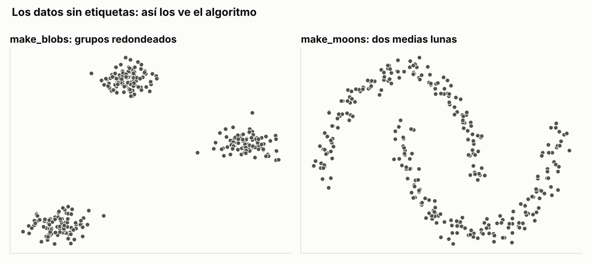
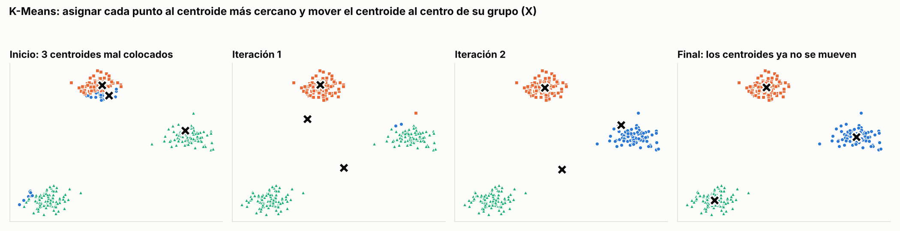
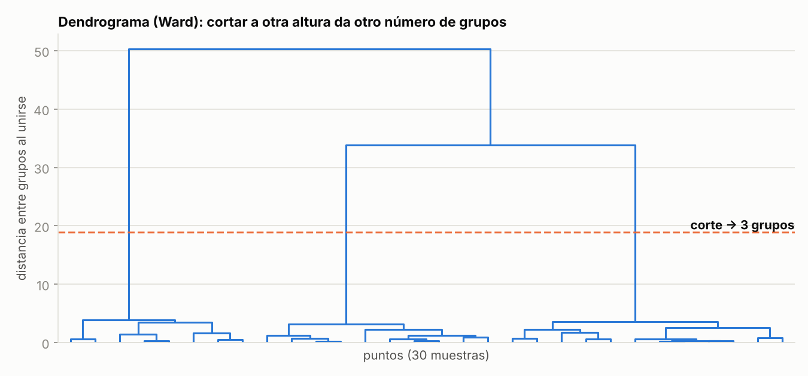
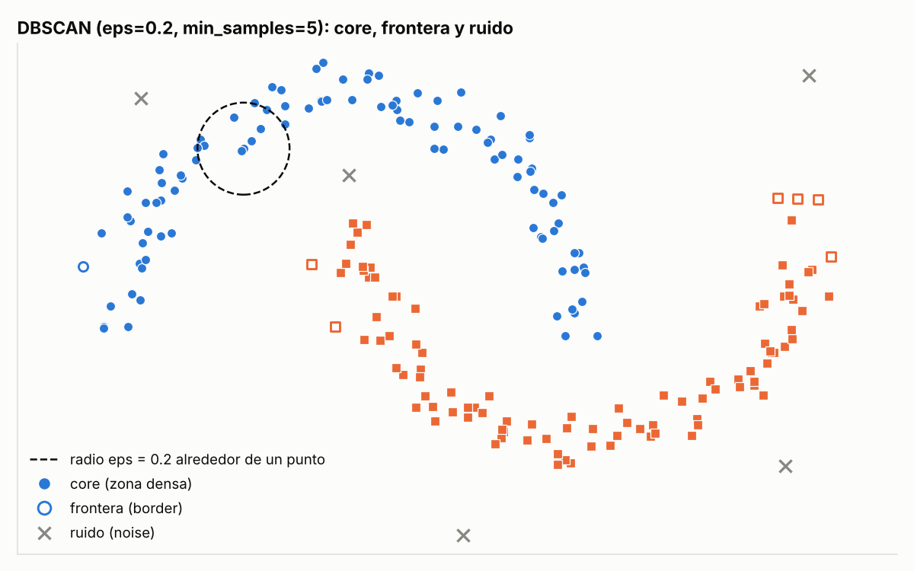
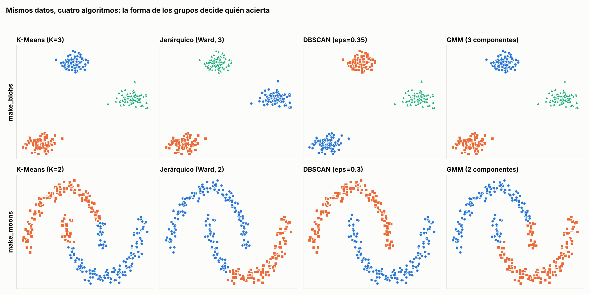
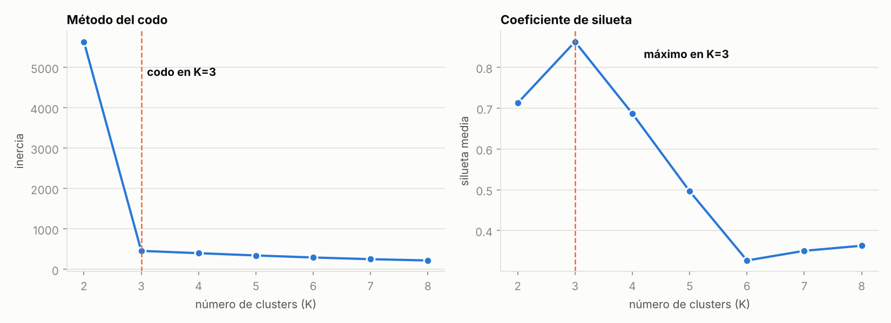

# 🔍 Investigación sobre algoritmos de clustering no supervisados

Autora: Rita Pereira · Bootcamp de Inteligencia Artificial · Noviembre 2026

Este README responde a las cinco preguntas de la investigación y se acompaña de ejemplos visuales con datos de juguete (`make_blobs` y `make_moons`). El código que genera todas las imágenes está en [`clustering_visual.py`](clustering_visual.py).

## 🧠 1. ¿Qué es el aprendizaje no supervisado y qué es un algoritmo de clustering? ¿En qué se diferencia del aprendizaje supervisado y cuál es su propósito?

El aprendizaje no supervisado es el tipo de aprendizaje automático que trabaja con datos sin etiquetas. Solo tenemos las características de cada elemento (por ejemplo edad, gasto y visitas de un cliente) y ninguna columna con la respuesta correcta. Lo que le pedimos al algoritmo es que encuentre por sí solo la estructura que hay en esos datos.

Un algoritmo de clustering es el más habitual dentro de este grupo. Su trabajo es agrupar los elementos de modo que los que están en el mismo grupo se parezcan entre sí y se diferencien de los de otros grupos. Lo que agrupa es la similitud global, medida normalmente con una distancia, y no una característica concreta. El resultado son grupos numerados (cluster 0, cluster 1...) y su significado lo interpretamos nosotros mirando qué tienen en común sus miembros.

La diferencia con el aprendizaje supervisado está en las etiquetas. En el supervisado entrenamos al modelo con ejemplos que ya traen la respuesta correcta, como "este cliente compró" o "este no compró". El modelo aprende qué patrones acompañan a cada etiqueta y su propósito es predecir la etiqueta de datos nuevos. Por eso necesita separar los datos en entrenamiento y test: así comprobamos si acierta con casos que no ha visto. En el no supervisado no hay respuesta correcta, así que normalmente no se hace este split y el propósito es explorar y descubrir grupos.

Creo que es importante entender que no supervisado no quiere decir que el modelo decida con total libertad. Nosotros elegimos el algoritmo, la forma de medir la similitud y a menudo el número de grupos. Además, como no hay etiquetas, es más difícil saber si el resultado es bueno. Montarlo es más sencillo que un modelo supervisado, pero evaluarlo e interpretarlo exige más criterio.

Algunas aplicaciones reales del clustering:

- Segmentación de clientes o de mercado, para adaptar campañas a cada grupo.
- Agrupar correos o documentos por temática cuando no tenemos categorías previas. Detectar spam es otro caso, y ese es supervisado, porque se entrena con correos ya marcados.
- Detección de anomalías o fraude, al identificar los elementos que no encajan en ningún grupo.
- Segmentación de imágenes, al agrupar píxeles parecidos.

Estos son los dos conjuntos de datos de juguete que uso en todo el trabajo. Fíjate en que no tienen ninguna etiqueta: son solo puntos, y el algoritmo tiene que decidir qué grupos hay.



## 🌳 2. Explique la diferencia conceptual entre el clustering basado en centroides (particional) y el clustering jerárquico, mencionando un algoritmo representativo de cada enfoque.

La diferencia entre los dos enfoques está en cómo construyen los grupos y en qué tengo que decidir antes de empezar.

El clustering basado en centroides, o particional, divide los datos en un número de grupos que fijo de antemano. Su algoritmo representativo es K-Means. Primero elijo K, que es el número de grupos. El algoritmo coloca K centroides al azar y asigna cada punto al centroide más cercano. Después mueve cada centroide al centro de los puntos que le han tocado y repite el proceso hasta que dejan de moverse. El resultado es una única división de los datos en K grupos, y como el punto de partida es aleatorio, dos ejecuciones pueden dar resultados algo distintos.

En el dibujo se ve el proceso con un inicio deliberadamente malo (dos centroides en el mismo grupo). Las X son los centroides y los colores y las formas indican el grupo al que pertenece cada punto en ese paso.



El clustering jerárquico no necesita que fije el número de grupos al principio. Su algoritmo representativo es el jerárquico aglomerativo. Empieza con cada punto como su propio grupo y va uniendo los dos grupos más cercanos hasta que todo queda en uno solo. El resultado es un dendrograma, un árbol con todas las uniones, y obtengo los grupos cortándolo a la altura que quiera. Aquí sí tengo que decidir cómo mido la distancia entre grupos, lo que se llama criterio de enlace o *linkage*. Ward, que une los grupos cuya fusión aumenta menos la variación interna, es el más usado y el que scikit-learn aplica por defecto.

La altura de cada unión en el dendrograma indica lo lejos que estaban los grupos que se juntan. La línea discontinua es un corte: todo lo que queda por debajo se queda como grupo, y aquí el corte da tres grupos.



Las dos formas se llevan bien con casos distintos. Según la guía de scikit-learn, K-Means escala a muestras muy grandes y a un número medio de clusters, y es de uso general con grupos de tamaño parecido y geometría plana. El aglomerativo maneja muchos clusters, admite restricciones de conectividad y distancias no euclídeas, y es más lento cuando crece el número de datos. Otra diferencia es que K-Means es inductivo, así que puede asignar un punto nuevo a un grupo sin repetir el proceso, y el aglomerativo es transductivo, así que si llegan datos nuevos hay que volver a calcularlo.

Un ejemplo de por qué importa el enfoque: con dos medias lunas entrelazadas, K-Means falla porque asigna cada punto al centro más cercano y corta las lunas por la mitad. El aglomerativo con linkage single sí puede separarlas, porque une los puntos más cercanos entre sí y sigue la curva de cada luna.

Resumiendo, K-Means pide K desde el inicio y devuelve una sola división, y el jerárquico no lo pide y devuelve un árbol con todos los niveles de agrupación.

**Fuente:** scikit-learn developers, *2.3. Clustering* (consultado el 23 de noviembre de 2026).

## 🗺️ 3. ¿En qué consiste el clustering basado en densidad (como DBSCAN) y cómo difiere su enfoque del clustering basado en centroides y del jerárquico?

El clustering basado en densidad agrupa los puntos según lo juntos que están, sin buscar centros. La idea es parecida a mirar un mapa con personas: las plazas llenas de gente son los grupos, y los paseantes sueltos de las calles vacías no pertenecen a ninguno.

DBSCAN lo convierte en algoritmo con dos parámetros. El primero es `eps`, el radio con el que miro alrededor de cada punto. El segundo es `min_samples`, el número mínimo de puntos que debe haber dentro de ese radio. Según esto, cada punto cae en una de tres categorías:

- **Punto core:** tiene al menos `min_samples` puntos dentro de su radio, así que está en una zona densa.
- **Punto frontera (border):** no cumple eso, pero está dentro del radio de un punto core, así que se une a su grupo.
- **Ruido (noise):** no es core y tampoco está cerca de ninguno, así que no pertenece a ningún grupo.

Los grupos se forman encadenando puntos core que son vecinos entre sí. Por eso un grupo puede tener cualquier forma, incluidas curvas, anillos o medias lunas.

En el dibujo se ven las tres categorías. El círculo discontinuo muestra qué significa `eps` alrededor de un punto: si dentro de ese círculo hay suficientes puntos, es un punto core. Los círculos huecos y cuadrados huecos son puntos frontera, y las cruces grises son ruido.



La diferencia con los otros dos enfoques es clara:

- **Frente a los centroides (K-Means):** DBSCAN no necesita fijar el número de grupos, no busca centros y no obliga a que todos los puntos pertenezcan a un grupo. K-Means asume grupos redondeados y asigna cada punto al centro más cercano.
- **Frente al jerárquico:** el jerárquico construye un árbol uniendo grupos por distancia y yo decido después dónde cortarlo. DBSCAN no construye ningún árbol, decide los grupos por densidad en una sola pasada y detecta el ruido por sí mismo.

Su punto débil es que depende mucho de elegir bien `eps` y `min_samples`, y le cuesta cuando los grupos tienen densidades muy distintas.

La comparación lo muestra con los mismos datos. Con grupos redondeados (fila de arriba) los cuatro algoritmos aciertan. Con dos medias lunas (fila de abajo) solo DBSCAN separa las dos lunas, y los demás las cortan por la mitad.



## 📏 4. ¿Por qué es importante elegir correctamente el número de clusters o los hiperparámetros de un algoritmo de clustering? Explica al menos dos métodos para evaluar la calidad de un agrupamiento (por ejemplo, el método del codo y el coeficiente de silueta).

En clustering no hay etiquetas correctas con las que comparar, así que elegir mal el número de clusters o los hiperparámetros cambia por completo el resultado sin que ningún error nos avise. Con K demasiado bajo mezclamos grupos distintos en uno solo. Con K demasiado alto partimos grupos naturales en trozos sin sentido. En DBSCAN, un `eps` pequeño convierte casi todo en ruido y uno grande junta todo en un único grupo. Por eso necesitamos métricas que nos ayuden a decidir.

### Método del codo (elbow)

Se ejecuta K-Means con distintos valores de K y se calcula en cada caso la inercia, que es la suma de las distancias al cuadrado de cada punto a su centroide. Al aumentar K la inercia siempre baja, porque los grupos son más pequeños. Se dibuja la inercia frente a K y se busca el "codo", el punto donde la mejora deja de ser grande. Ese K es una buena elección. Su límite es que a veces el codo no se ve con claridad.

### Coeficiente de silueta

Para cada punto se compara dos distancias: `a`, la distancia media a los demás puntos de su grupo, y `b`, la distancia media a los puntos del grupo más cercano que no es el suyo. La silueta es `(b - a) / max(a, b)` y va de -1 a 1. Un valor cercano a 1 indica que el punto está bien asignado, cerca de 0 que está en la frontera entre dos grupos, y negativo que probablemente está en el grupo equivocado. Se calcula la media de todos los puntos para cada K y se elige el K con la silueta más alta. A diferencia del codo, ofrece un número que se puede comparar, y también sirve con otros algoritmos además de K-Means.

En los datos de `make_blobs`, que tienen tres grupos, el codo aparece en K=3, donde la inercia deja de bajar de golpe, y la silueta alcanza su máximo también en K=3.



En la práctica uso las dos métricas junto con un gráfico de los datos, porque ninguna sustituye a mirar si los grupos tienen sentido.

## 🧩 5. Explica brevemente los siguientes algoritmos

- K-Means
- Clustering Jerárquico (Aglomerativo)
- DBSCAN
- Gaussian Mixture Models (GMM)

Para cada uno se incluye una breve descripción del mecanismo, ventajas, desventajas y casos de uso comunes.

### K-Means

**Mecanismo:** el usuario fija K. El algoritmo coloca K centroides, asigna cada punto al más cercano, recalcula cada centroide como el promedio de sus puntos y repite hasta que no cambian.

**Ventajas:**

- Es sencillo y fácil de interpretar.
- Es rápido y escala a conjuntos muy grandes.
- Permite asignar puntos nuevos sin repetir el proceso.

**Desventajas:**

- Hay que decidir K de antemano.
- Es sensible a la inicialización y a los valores atípicos.
- Asume grupos redondeados y de tamaño parecido, y falla con formas irregulares.
- Necesita variables escaladas.

**Casos de uso:** segmentación de clientes, compresión de imágenes por reducción de colores y agrupación de documentos.

### Clustering jerárquico aglomerativo

**Mecanismo:** cada punto empieza como su propio grupo y se van uniendo los dos grupos más cercanos según el criterio de enlace (Ward, complete, average o single). El resultado es un dendrograma que se corta a la altura deseada.

**Ventajas:**

- No exige fijar K desde el principio.
- El dendrograma muestra la estructura a todos los niveles.
- Admite distintos criterios de enlace y distancias.

**Desventajas:**

- Es más lento y consume más memoria cuando crece el número de datos.
- Una unión ya hecha no se deshace.
- El resultado depende del linkage elegido.
- No asigna puntos nuevos sin recalcular.

**Casos de uso:** taxonomías en biología y genética, análisis exploratorio con pocos datos y organización de documentos por temas.

### DBSCAN

**Mecanismo:** para cada punto cuenta los vecinos dentro de un radio `eps`. Si hay al menos `min_samples`, es un punto core y forma parte de una zona densa. Los grupos se construyen encadenando puntos core vecinos, y los puntos aislados se marcan como ruido.

**Ventajas:**

- No requiere fijar el número de grupos.
- Encuentra grupos de forma arbitraria.
- Detecta valores atípicos como ruido.

**Desventajas:**

- Es sensible a la elección de `eps` y `min_samples`.
- Le cuesta cuando los grupos tienen densidades muy distintas.
- Pierde eficacia en datos con muchas dimensiones.

**Casos de uso:** detección de anomalías y fraude, agrupación de ubicaciones geográficas y limpieza de ruido en los datos.

### Gaussian Mixture Models (GMM)

**Mecanismo:** supone que los datos vienen de una mezcla de distribuciones normales (gaussianas), una por grupo. Con el algoritmo EM (Expectation-Maximization) estima la media, la forma y el peso de cada una. En lugar de asignar cada punto a un solo grupo, calcula la probabilidad de que pertenezca a cada uno.

**Ventajas:**

- Da asignaciones suaves, con probabilidades, y admite solapamiento entre grupos.
- Se adapta a grupos elípticos de distinto tamaño y orientación, no solo redondos.
- Permite elegir el número de componentes con criterios como BIC o AIC.

**Desventajas:**

- Hay que decidir el número de componentes.
- Asume que los grupos son gaussianos.
- Puede converger a una solución local según la inicialización.
- Es más costoso que K-Means.

**Casos de uso:** segmentación donde los perfiles se solapan, estimación de densidad y detección de anomalías.

## 💻 Código y cómo reproducir las imágenes

Todas las imágenes de este README se generan con el script [`clustering_visual.py`](clustering_visual.py), que usa `scikit-learn`, `matplotlib`, `scipy` y `numpy`. Para ejecutarlo:

```bash
pip install -r requirements.txt
python clustering_visual.py
```

El script guarda las seis imágenes en la carpeta `images/`.

## 📚 Bibliografía

- scikit-learn developers. *2.3. Clustering*. scikit-learn documentation. https://scikit-learn.org/stable/modules/clustering.html (consultado en noviembre de 2026).
